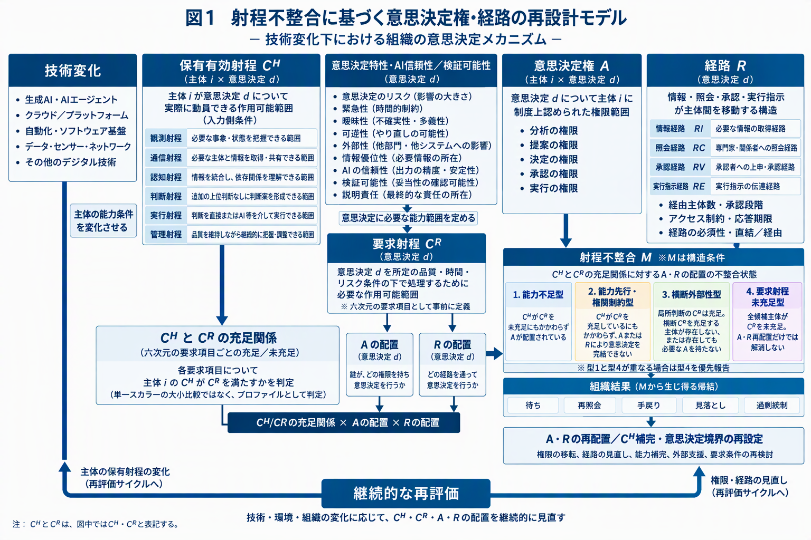

# AI時代のSIer組織における射程・権限・経路不整合の概念モデル

- **English title:** A Conceptual Model of Reach-Authority-Routing Misalignment in SIer Organizations in the AI Era
- **Author:** Satoshi Aoyagi
- **Document type:** Conceptual Paper / Preprint
- **Version:** 1.8（診断構造・測定独立性強化版）
- **DOI（all versions）:** 10.5281/zenodo.24539886

本稿は未査読の概念論文である。内容は今後の研究、読者からのフィードバック、および査読過程に応じて改訂される可能性がある。

### 要旨

生成AIおよびAIエージェントは、組織内の主体が特定の意思決定について実際に動員できる作用範囲を急速かつ不均等に変化させる。本稿における「射程」は物理的距離や権限範囲ではなく、情報、技術、接続、支援を動員して特定の意思決定に実際に作用できる範囲を指す。本稿はこの意思決定固有の範囲を保有有効射程（Held Capability Reach: CH）と定義し、当該意思決定を所定の品質・時間・リスク条件で処理するために必要な要求射程（Required Capability Reach: CR）から区別する。さらに、制度上の意思決定権Aと、情報・照会・承認・実行指示の経路Rを独立した構成要素として扱う。

本稿が提示する射程不整合Mは、成果指標ではなく、個別の意思決定dについてCH、CR、A、Rの配置関係に生じる構造条件である。具体的には、能力不足型、能力先行・権限制約型、横断外部性型、要求射程未充足型の四類型を区別する。技術変化はCHを変化させる一方、意思決定特性およびAI出力の信頼性・検証可能性はCRを形成する。この両者の充足関係を踏まえ、AとRを意思決定単位で再配置する必要がある。

本稿の理論的価値は、四変数の列挙ではなく、既存理論を単独で適用すると同じ表面的症状として同一化されやすい状態を、異なる組織設計介入へ弁別する診断的説明力にある。本稿は、組織情報処理、知識と意思決定権、調整、IT・AIと組織設計、team autonomy/controlの知見を、個別意思決定dという共通の分析単位へ写像する。Mは待ちや手戻りの結果ではなく、介入前に判定される構造診断として定義し、M1～M4を異なる介入候補へ接続する。最後に、AおよびRを追加した四変数モデルの追加的説明力を検証する三つの中核命題、SIer文脈への一つの応用命題、および理論を組織設計実務へ変換する「意思決定図」を提示する。軍事的事例は概念抽出のための限定的参照であり、実証証拠としては用いない。

---

### 1. はじめに

#### 1.1 問題の所在

生成AIやAIエージェントの組織導入は、コード生成、情報検索、文書作成、分析、設計支援等の自動化・高度化として論じられることが多い。しかし組織設計の観点では、技術が変えるのは単位作業の所要時間だけではない。従来は複数の専門家や階層を経由しなければ扱えなかった情報の収集、比較、判断、実行を、一人または一チームが連続的に扱えるようになれば、その主体が組織内で有効に作用できる範囲自体が変化する。

この問題は、技術能力と組織上の権限が自動的には連動しないことによって重要になる。あるエンジニアがAIを用いて複雑なクラウド構成を設計・検証できるとしても、本番変更がセキュリティ、契約、コスト、全社アーキテクチャ、他システムへ大きな影響を及ぼすなら、最終決定権まで当該エンジニアへ付与することが合理的とは限らない。逆に、低リスクかつ可逆的な変更について現場の判断能力が十分に高まっても従前の承認経路を維持すれば、承認待ちが技術的作業より大きなボトルネックとなり得る。

したがって問うべきなのは、「AIによって能力が高まったため権限委譲すべきか」ではない。**技術によって能力範囲が変化した後も、従来の意思決定権、情報経路、承認経路の配置がなお合理的であるか**である。

#### 1.2 研究ギャップ

組織設計研究は、情報処理能力、固有知識と意思決定権、formal/real authority、調整、人間・AI意思決定、team autonomy/controlを各々詳細に扱ってきた。研究ギャップは、これらが未研究であることではない。

問題は、単独適用した場合、同じ「遅い」「権限が足りない」「調整が必要」という症状の背後にある、能力不足、権限不足、経路過剰、横断要求の未充足を十分に弁別しにくいことである。これらは同じ症状でも、CH補完、A再配置、R再設計、意思決定境界の再設定という異なる介入候補を持つ。本稿は、能力、要求、権限、経路を個別の意思決定dへ写像し、この構造差を識別することを研究課題とする。

#### 1.3 研究質問

> **RQ：技術革新によって各主体のCHが変化したとき、意思決定dのCRとの充足関係を踏まえ、SIerにおけるAおよびRはいかなる条件のもとで再配置されるべきか。**

##### 1.3.1 なぜSIerを研究文脈とするのか

SIerは、本稿の概念モデルを検討する上で理論的に有用な研究文脈である。システム開発プロジェクトでは、開発・インフラ・セキュリティ・品質・運用等の専門領域、顧客・ベンダー・社内組織間の依存関係、技術判断と管理判断、さらにPM、PL、PMO、アーキテクト等の役割分化が同一の仕事の連鎖に併存する。このため、ある主体の技術的・認知的能力が変化しても、意思決定権や承認構造、横断調整の必要性が同じ方向には変化しない状況を観察しやすい。

したがって本稿は、SIerを理論の適用対象を永久に限定する境界としてではなく、**CH/CRの充足関係とA・R配置の不整合が顕在化しやすい知識集約型・相互依存型の研究文脈**として位置付ける。本モデルが他の知識集約型組織にも妥当するかは、将来の外的妥当性検証の対象とする。

#### 1.4 本稿の貢献

本稿の理論的貢献は、能力、要求、権限、経路という既知の問題を単に一つの枠組みに集約することではない。主要な貢献は、これらを個別の意思決定dという共通の分析単位へ写像することにより、既存概念を単独で適用した場合に同一化されやすい構造状態を識別可能にする点にある。

第一に、主体iが意思決定dについて実際に動員できる作用可能範囲CH(i,d)と、当該意思決定が所定の品質・時間・リスク条件のもとで要求するCR(d)を分離する。これにより、主体側の動員可能性の不足と、意思決定側の要求条件の高さを区別する。

第二に、CH/CRの充足関係から制度的意思決定権Aと経路Rを分離する。これにより、「能力が不足している」「能力はあるが権限がない」「能力と権限はあるが必須経路が完結を妨げる」「局所的能力はあるが横断的要求を充足できない」といった状態を、異なる原因構造として診断できる。

第三に、射程不整合Mを成果の悪さではなく、CH、CR、A、Rから成果観測前に判定可能な構造条件として定義する。待ち、再照会、手戻り、見落とし、過剰統制をMの定義から除外し、M類型ごとに適合する組織設計介入を識別できるようにする。したがってMは分類体系であるだけでなく、**構造状態と介入原理を接続する診断モデル**である。

第四に、技術変化を権限の分権化へ直接結び付けない。AIはCHを急速に変化させる重要な技術条件であると同時に、信頼性、検証可能性、説明責任を通じてCRにも影響し得る。望ましいAおよびRは、一方向の中央集権化・分権化ではなく、意思決定dごとのCH/CR充足関係に応じて再評価される。

したがって本稿の追加的説明力は新語の導入自体ではない。同じ表面的症状を、異なる介入を必要とする構造状態へ分解し、CH/CRだけでは予測できないA・Rの追加的効果を反証可能な研究命題へ接続する点にある。

---

### 2. 先行研究

#### 2.1 組織情報処理と組織設計

Galbraith (1974) の情報処理観では、課業の不確実性は組織形態と関係し、認知的限界のもとで情報システムや集団的問題解決を含む組織設計上の対応が必要になる。Daft and Lengel (1986) はさらに、不確実性だけでなく多義性を区別し、組織構造と内部システムが管理者に提供する情報量と情報の豊かさを規定すると論じた。

本稿のCHはこれらの情報処理能力概念と接続するが、同一ではない。CHは情報量や恒常的な主体能力ではなく、特定の意思決定dについて主体iが当該時点で実際に動員できる観測・通信・認知・判断・実行・管理の作用可能範囲である。さらにCRを導入することで、主体側の保有能力と意思決定側の要求条件を分離する。この点で、本稿の分析対象は権限それ自体でも一般的能力でもなく、**意思決定固有の要求に対する主体の作用可能範囲と制度配置の関係**である。

#### 2.2 知識と意思決定権

Jensen and Meckling (1995) は、意思決定に有用な知識を一人または少数の専門家へ完全に集約することには限界があり、固有知識の移転コストを踏まえて意思決定権を配置する必要があると論じた。Aghion and Tirole (1997) は、formal authorityを決定する権利、real authorityを意思決定に対する実質的統制として区別し、実質的権限が情報構造に左右されることを示した。

これらは本稿のCH・CR・A・Rの分離に重要な理論的基盤を与える。ただし、本稿のCHはreal authorityそのものではない。CHは主体iが意思決定dについて実際に動員できる作用可能範囲であり、その範囲が広くても制度上のAを持つとは限らない。したがって、本稿はCH、CR、A、Rを別変数として扱う。

#### 2.3 調整と依存関係

Malone and Crowston (1994) は、調整を活動間の依存関係を管理する過程として定義した。この観点は、なぜ現場主体のCHが拡大しても必ずしもAを現場へ移せないのかを理解する上で重要である。個別主体が自己完結的に判断できても、その判断が共有資源、他チーム、他システム、同時性制約等に依存するなら、組織的調整は残る。

本稿では、この問題を「外部性」と「情報優位性」等の意思決定特性として扱い、CHだけではAを決定できず、意思決定dのCRとRも評価する必要がある理由の一つとする。

#### 2.4 ITと組織再設計

Bresnahan et al. (2002) は、企業レベルのデータから、IT、職場組織の再設計、技能の間に補完性があることを示し、ITの効果を技術単体ではなく組織的変化と合わせて考える必要性を示した。これは、AI導入を既存の組織構造へ単純に追加するのではなく、職務や意思決定配置を含む組織設計との補完関係として考える本稿の立場と整合する。

#### 2.5 AIと組織的意思決定

Shrestha et al. (2019) は、人間とAIの意思決定特性を比較し、状況に応じて完全委譲、逐次的な人間・AIの組合せ、集約型の意思決定構造を選択する枠組みを提示した。Dellermann et al. (2019) は、人間と機械の相補性をHybrid Intelligenceとして概念化した。Raisch and Krakowski (2021) は、automationとaugmentationを単純な二者択一として扱うことを批判し、両者の相互依存を指摘した。Faraj et al. (2018) は、学習アルゴリズムが専門性、職務境界、調整、統制へ影響し得ることを論じた。

さらに、MIT CISRのSebastian et al. (2026) は、人間と自律的AIの意思決定権を設計する上で「曖昧性」と「リスク」を主要な二軸として提示している。本稿はこの問題意識を引き継ぎながら、AIへの委譲だけでなく、人・チーム・管理側・支援側の能力変化を同一枠組みで扱い、可逆性、緊急性、外部性、情報優位性、検証可能性、説明責任等を含む意思決定配置へ議論を拡張する。

#### 2.6 既存研究との位置関係

既存研究は、情報処理、知識と権限、調整、技術変化、AIとの意思決定分担を各々説明するが、同一の意思決定dにおける要求、主体の実効的作用範囲、制度的権限、必須経路の配位を同時には識別しない。本稿はこれらを入れ替え可能な概念の再命名ではなく、役割の異なる説明変数として区別する。表1は、その理論的識別を示す。

**表1　CH/CR/A/Rの理論的識別**

| CH / CR | A | R | 四変数モデルによる識別 | 単一概念では識別しにくい理由 |
|---|---|---|---|---|
| 充足 | あり | 非合理的に複雑 | 能力・権限はあるが経路が完結を妨げる | 能力または権限だけなら問題を検出しにくい |
| 充足 | なし | 簡素 | 能力はあるが制度的権限がない | real authorityのみでは形式配置と実行経路を分けにくい |
| 充足 | あり | 簡素 | 局所的には整合。ただし横断CRの別途評価が必要 | CHのみでは外部性に必要な要求を捉えない |
| 未充足 | あり | 簡素 | 能力不足型。経路変更では解消しない | 情報処理能力と権限の不一致だけでは要求側を固定できない |
| 全候補主体で未充足 | 任意 | 任意 | 要求射程未充足型。能力・境界の介入が必要 | 主体能力の平均や権限再配分では候補集合全体の欠落を表せない |

この識別の実務的含意は、同じ観測症状に対して表面的に似た処方が異なる原因状態を悪化させ得る点にある。表1aは、分離前には起こり得る誤診と、本モデルによる介入選択を対比する。

**表1a　表面的症状からの誤診と四変数診断**

| 観測された問題 | 表面的処方 | 四変数による診断 | 理論的に適合する主要介入 |
|---|---|---|---|
| 意思決定が遅い | 承認を減らす | S(i,d) = 0 | CH補完または充足主体へのA再配置 |
| 意思決定が遅い | 人員を増やす | S(i,d) = 1、Aが不足 | A再配置 |
| 意思決定が遅い | 権限を委譲する | S(i,d) = 1、Rが過剰 | R再設計 |
| 現場能力が高い | 完全に委譲する | 局所CRは充足するが横断CRが未充足 | 横断主体・A・Rを維持または再設計 |
| 誰も完結できない | 上位者へ移管する | 全候補主体がCRを未充足 | CH補完または意思決定境界・CRの再設定 |

表1が構造状態の理論的識別を扱うのに対し、表1aはその識別を組織設計上の誤診回避へ接続する。したがって両表の役割は重複しない。

このモデルが追加する最小限の反実仮想は、次の二つである。第一に、CH/CR充足とRを固定してA配置だけが異なる場合、同じ作用可能性でも制度的完結可能性、待ちおよび適合介入が異なると予測する。第二に、CH/CR充足とAを固定してR構造だけが異なる場合、RVの必須段階や過剰経路は調整負荷へ、RI・RCの接続は情報・専門知識へのアクセスへ異なる効果を持ち得る。したがってCH/CRだけのモデルでは同一視される状態を、A・Rの分離によって識別し、異なる結果と介入を比較可能にする点が本稿固有の追加的説明力である。

---

### 3. 研究方法

#### 3.1 研究デザイン

本稿は、実証研究ではなく、複数の研究領域から概念を統合して説明モデルを構築する概念研究である。目的は、SIerにおけるAI導入後の能力変化と意思決定権配置を説明するための概念枠組みを提示し、後続する実証研究で検証可能な研究命題を導出することにある。

なお、本稿は体系的文献レビューを目的とするものではなく、文献集合の網羅性、効果量の統合、研究数の集計を研究成果とするものではない。参照文献は、隣接概念との境界を明らかにし、概念間の関係を統合して理論モデルを構築するための理論的基盤として用いる。したがって、本稿における文献統合の妥当性は、検索結果の網羅性それ自体ではなく、主要な隣接理論との対話、概念境界の明確性、導出される命題の論理的一貫性によって評価されるべきである。

#### 3.2 分析対象

概念構築にあたり、本稿は次の四群の文献・資料を参照する。

- 組織情報処理、知識、意思決定権、調整に関する組織論
- IT・AIと組織設計、人間とAIの意思決定に関する研究
- 技術変化と指揮統制変化を考察するための19世紀プロイセン軍関連資料
- AI・情報通信技術と将来の指揮統制を扱う現代軍事組織の公開研究資料

軍事資料はSIerに対する直接的な実証根拠とはせず、技術変化、能力範囲、指揮統制構造の関係を比較する歴史的・現代的参照例として扱う。

#### 3.3 概念モデルの構築手順

第一に、分析単位を個別の意思決定dに固定し、主体iがその意思決定について実際に動員できる六次元の作用可能範囲をCHとして概念化する。第二に、成果から逆算せず、意思決定特性および事前に定める品質・時間・リスク条件から、その意思決定に必要な六次元の要求をCRとして分離する。第三に、制度上の意思決定権Aと、情報・照会・承認・実行指示の経路Rを独立させる。第四に、CHとCRの充足関係にA・Rの配置を重ね、四類型の構造条件として射程不整合Mを導出する。第五に、Mとは独立した結果変数として、待ち、再照会、手戻り等を置く。最後に、競合説明を明示したうえで反証可能な研究命題を導出する。

理論基盤の選択原理は、(1) 能力・情報処理、(2) 知識と意思決定権、(3) 活動間調整・経路、(4) 技術と組織設計、(5) AI・自動化と自律性／統制の少なくとも一つを直接説明し、かつCH、CR、A、Rの境界または因果関係へ制約を与える研究を優先することにある。単にAIまたはSIerを扱うだけの資料は、これらの概念境界に理論的制約を与えない限り主資料から除外する。

#### 3.4 歴史的比較の位置付け

歴史的比較は、因果関係の実証ではなく概念抽出のための限定的参照である。19世紀プロイセン軍から抽出するのは、技術変化に伴う主体の作用可能範囲の変化と、指揮・情報・支援構造の再設計という関係だけである。軍事組織とSIerの制度的帰結は異なるため、事例は本モデルの妥当性を検証せず、理論的感度を高める素材としてのみ用いる。

---

### 4. 理論枠組み

本稿では記号を次のように用いる。

| 記号 | 定義 |
|---|---|
| CH(i,d) | 主体iが意思決定dについて当該時点で実際に動員できる作用可能範囲 |
| CR(d) | 意思決定dを所定条件で処理するための要求射程 |
| S(i,d) | CH(i,d)がCR(d)の全必須要求項目を充足するかを示す二値指標 |
| A(i,d) | 意思決定dについて主体iに制度上認められた権限範囲 |
| R(d) | 情報・照会・承認・実行指示の経路構造 |
| M(d) | CH/CR、A、Rの配位から診断される射程不整合 |

#### 4.1 保有有効射程 CH

本稿は、主体一般の能力ではなく、**特定の意思決定 d について主体 i が当該時点で実際に動員できる作用可能範囲**を「保有有効射程（Held Capability Reach）CH(i,d)」と定義する。CHは、アクセス可能な情報、利用可能な技術、人間の技能、接続可能な主体、組織的支援を組み合わせ、当該意思決定について実際に利用できる範囲である。AI等の技術はCHそのものではなく、CHを変化させる要因の一つである。

CHは、主体の一般的能力、専門技能、保有資源、職位、制度的権限、情報アクセスまたはAI性能そのものを意味しない。これらはCHを成立・変化させる背景条件または入力である。CHが表すのは、複数の条件が特定意思決定の場面で結合した結果として、主体が**実際に作用できる到達範囲**である。したがって、

> **CH ≠ Skill**
>
> **CH ≠ Resource**
>
> **CH ≠ Authority**
>
> **CH ≠ AI Capability**
>
> **CH = Decision-specific Effective Actionable Reach**

である。

本稿が「能力」ではなく「射程（reach）」を用いるのは、分析対象が能力の強度ではなく、その能力と情報・技術・接続・支援を特定の意思決定dについて動員したときに実際に及ぶ範囲だからである。同一の技能を持つ主体でも、利用可能なデータ、接続可能な専門家、AI・自動化環境、実行環境、支援資源が異なればCH(i,d)は異なる。この命名は能力を捨象するものではなく、能力を組織的・技術的条件と結び付け、意思決定固有の作用可能性として捉え直すための理論的選択である。

CHは次の六次元から構成される。

- 観測射程：必要な事象・状態を把握できる範囲
- 通信射程：必要な主体との間で情報を取得・共有できる範囲
- 認知射程：情報を統合し、依存関係や選択肢を理解できる範囲
- 判断射程：追加の上位判断なしに判断案を形成できる範囲
- 実行射程：判断を直接またはAI・自動化を介して実行へ移せる範囲
- 管理射程：一定の品質を維持しながら継続的に把握・調整できる範囲

この定義により、CHは「能力全般」や恒常的な個人特性から区別される。同一人物でも、アクセス権、利用可能なAI、対象システム、意思決定の種類が異なればCH(i,d)は異なり得る。

##### 4.1.1 CHの追加的予測差

CHの独立性は、入力条件を列挙したことだけでは成立しない。技能、役職、formal authority、保有ツールのいずれかを固定しても、意思決定開始時点にそれらを一つの必要行為へ動員できるかが異なればCHは異なり、次の予測差を生む。

- 同じ技能・資格を持つ二主体でも、一方だけが必要なデータ、実行環境、専門家支援を期限内に動員できる場合、動員可能な主体の意思決定完結可能性が高い。
- 同じ情報処理能力とAを持つ二主体でも、一方の実行または管理射程が不足すれば、認知・判断が同等でも全必須要求項目を充足しない。
- 同じAと資源保有量を持つ二主体でも、必要な時点に情報、技術、接続、支援を組み合わせられるかが異なればCHが異なり、Aだけでは予測できないM1成立差が生じる。

CHの新規性は、既存入力の再命名ではなく、入力条件の存在から当該dでの動員可能性への組合せを測る点にある。これらの予測差が既存の技能・資源・Aの組合せで再現され、CHおよびS(i,d)に追加説明がない場合、CHを独立構成概念として保持する必要性は支持されない。

##### 4.1.2 六次元の理論的導出

六次元は、確定した自然分類や完成済み尺度ではなく、意思決定固有の要求項目と入力側証拠を分類するための、理論的に導出された暫定的次元である。認知機能の加算的な尺度や職務分類ではなく、意思決定が入力から実行後管理まで成立するための**作用過程**を記述する分析カテゴリーとして用いる。採用基準は、(1) 意思決定の前提情報を獲得する過程、(2) 他主体との依存を処理する過程、(3) 情報を解釈し判断案を形成する過程、(4) 選択を組織行為へ変換する過程、(5) 結果発生後も責任ある状態を維持する過程、を概念的役割の違いを保ちながら全体として覆うことである。組織情報処理は主として観測・通信・認知を、意思決定権研究は判断・実行を、調整研究は通信・実行・管理を照らす。六次元はこれらを意思決定単位へ再編したものである。

各次元は相互独立ではなく機能的に区別される。観測された情報を理解できなければ認知が不足し、理解できても制度上または技術上実行へ移せなければ実行が不足する。したがって相関の低さを前提とせず、別次元の不在が実質的に異なる介入を要することを識別基準とする。例えば観測不足はデータアクセスの改善、通信不足は接続相手・媒体の整備、認知不足は分析能力・専門支援、判断不足は判断案形成能力、実行不足は実行環境・資格、管理不足はモニタリング・是正能力の追加を必要とし得る。

網羅性は、要求項目を「得る（観測・通信）—理解して案を作る（認知・判断）—行為化し維持する（実行・管理）」という三段階に配置できるかで評価する。実証で分類不能な必須要求項目が反復して現れれば、理論上の欠落として新次元または既存次元の再定義を検討する。逆に、ある二次元が常に同一の要求項目と入力証拠に縮約されるなら、次元統合の根拠となる。したがって六次元は不変の自然な分類ではなく、意思決定過程を可測定に分解するための事前仮説である。

#### 4.2 要求射程 CR

意思決定dを、所定の品質・時間・リスク条件の下で処理するために必要な作用可能範囲を「要求射程（Required Capability Reach）CR(d)」と定義する。CRは意思決定のリスク、曖昧性、可逆性、緊急性、外部性、情報分布、検証可能性、説明責任等によって異なる。

CHとCRを分けることで、「主体が何をできるか」と「その意思決定が何を要求するか」を分離する。AI導入はCHを拡張し得る一方、AI出力の信頼性が低い、または検証が困難である場合には、人間側により広い検証・説明能力が必要となり、CRが高くなる可能性がある。

##### 4.2.1 CH/CR充足の最小形式化

六次元をk = 1,…,6として、主体iと意思決定dについてCH(i,d) = (CH1(i,d),…,CH6(i,d))、CR(d) = (CR1(d),…,CR6(d))と表す。各要素は単純な能力点ではなく、その次元に事前定義された要求項目プロファイルである。

S(i,d)をCH/CRの充足指標とし、意思決定dの全必須要求項目を主体iのCHが満たすときS(i,d) = 1、一つ以上を満たさないときS(i,d) = 0とする。すなわち、

> **S(i,d) = 1 ⇔ CH(i,d)がCR(d)の全必須要求項目を充足**

である。この定義は`CH > CR`という単一スカラーの大小比較を行わず、六次元のプロファイル一致として充足を扱う。具体的な判定規則は第12.3節に示す。

#### 4.3 意思決定権 A

意思決定権A(i,d)は、意思決定dについて主体iに制度上認められた分析・提案・決定・承認・実行の権限範囲を指す。CHが「実際に扱える範囲」であるのに対し、Aは「制度上扱ってよい範囲」である。したがって、能力があることと決めてよいことは同一ではない。

この区別はformal authorityとreal authorityの議論と接続するが、CHをreal authorityの言い換えとはしない。CHは権限概念ではなく、権限配置を評価する前提となる意思決定固有の作用可能範囲である。

CHは**現行配置下で実現された作用可能範囲**を測る。すなわち、技術・情報・技能・実行環境・接続資源を、Aによる制度的資格とは分けて、意思決定開始時点に実際に利用できるかを判定する。A・Rを仮に取り除いた潜在能力はCHの主測定には含めず、必要な場合にのみ反実仮想分析として別記する。

#### 4.4 経路 R

情報経路、照会経路、承認経路、実行指示経路を、Aとは独立した「経路（Routing Structure）R(d)」として扱う。Rは、意思決定dに必要な情報、判断案、承認、実行指示が主体間を移動する構造である。本稿はRを単一スカラーではなく、四つの機能的下位経路から構成される上位概念として扱う。ここでの「構成」は反映的・形成的のいずれかを先取りするものではなく、下位経路を同一の複雑性得点へ当然に集約しないという測定上の限定も示す。

- 情報経路RI：必要な情報へ到達し、意思決定主体から関連主体へ必要情報を共有する経路
- 照会経路RC：判断形成時に専門知識・助言を求め、回答を受ける経路
- 承認経路RV：提案が制度上の承認者を通る経路
- 実行指示経路RE：決定を実行主体へ伝達し、必要に応じて確認・復命を受ける経路

各下位次元は、必須／任意、直結／経由、経由主体数、段階数、アクセス制約、応答期限によって記述する。これらは同一方向へ必ず動くわけではない。例えば情報経路を広く保ちながら承認経路を短縮でき、照会経路は多くても必須承認段階が少ない場合がある。したがって実証では、Rの総合指数に先立ち下位次元を別々に記録する。複雑性の合成指標は、加算前に測定不変性と相関構造を確認し、理論的に同一作用を持つ次元に限定して用いる。

本稿における「Rが過剰」とは、経由主体数や段階数が単に多いことを意味しない。意思決定dのCR、外部性、契約・規制要件、リスクおよび説明責任を処理するために事前に必要とされた経路を超えて、意思決定完結を制約する必須経路が存在する状態を指す。したがってRの複雑性とR過剰は別の測定概念であり、前者は記述指標、後者は必要性基準との比較による構造診断である。

CHとRは相互依存し得るが、同じ観察を二重計上しない。CHには、情報源・専門家・実行環境へ**到達し実際に利用できること**を割り当てる。Rには、その到達を構成する必須経由、順序、段階、承認義務、応答期限を割り当てる。例えば、専門家へ連絡できることはCHの通信射程、専門家照会が契約・規程上必須であることはRCである。Rの変更が到達可能性を変える場合、それはR→CHの媒介効果として記録し、Rそのものの定義へ吸収しない。

この分離により、例えば「意思決定権は現場へ委譲されたが、旧来の承認経路が残っている」といった状態を、AとRの異なる配置として扱うことができる。

#### 4.5 射程・権限・経路不整合 M

本稿では、CHとCRの充足関係に対するAおよびRの配置上の不整合を**射程・権限・経路不整合（Reach-Authority-Routing Misalignment: M）**と呼ぶ。Mは一般的な非効率や組織fitの低さではなく、個別の意思決定dについて、CHとCRの充足関係に対し、AまたはRが特定の診断段階で制約となる構造状態である。M1～M4は相互排他的・網羅的な四象限ではなく、階層的な診断順序で検出される重複可能な診断カテゴリーとして扱う。待ち、再照会、手戻り、見落とし、過剰統制はMの定義要素ではなく結果変数である。

##### 4.5.1 階層的診断順序

1. **集合水準**：候補主体集合に、CRの全必須要求項目を充足できる主体が一人も存在しないか。存在しなければM4を報告する。
2. **主体水準**：責任主体のCHがCRを未充足であるにもかかわらず、その主体にAが配置されているか。該当すればM1を報告する。
3. **完結水準**：S(i,d) = 1の主体が存在するにもかかわらず、必要なA不足、R制約、または両方によって意思決定を完結できないか。該当すればM2を報告し、M2-A、M2-R、M2-ARを第二階層で記録する。
4. **横断水準**：dのCRに局所要求と横断要求が事前に含まれ、横断要求を充足する主体またはその主体に必要なA/Rが欠落するか。該当すればM3を報告する。

この順序では、M4は候補集合水準、M1・M2は特定主体の配置水準、M3は横断要求との関係で検出される。類型の併存を認めつつ、介入の主要原因を再現可能に報告する。

M3の独立性は意思決定境界dの事前固定に依存する。dが契約、規制、アーキテクチャまたはガバナンス上、局所部分の選択に加えてシステム間外部性の統合を必須の一つの意思決定として定める場合、そのdは局所CRと横断CRの二層を持つ。この場合M3は、局所主体が前者を充足しても、後者を処理する横断機能のCH・A・Rが欠落するマルチレベル不整合である。外部性をdの外へ事後的に切り出すことは分類の恣意性を生むため、M3判定前に横断統合をdのCRへ含めるかを記録する。横断統合が別個の意思決定d2として事前定義される場合、それはd1のM3ではなく、d2に対するMを別々に評価する。

- **能力不足型**：CH(i,d)がCR(d)を充足しないにもかかわらず、A(i,d)が当該主体へ配置されている。
- **能力先行・権限制約型**：CH(i,d)がCR(d)を充足しているにもかかわらず、AまたはRにより当該主体が意思決定を完結できない。
- **横断外部性型**：局所判断のCRは充足しているが、外部性の観測・統合・調整に必要なCRを充足する主体が存在しない、または存在しても当該意思決定に必要なAを持たない。
- **要求射程未充足型**：意思決定dに関与し得る全ての候補主体について、CHがCRの一つ以上の必須次元を充足しない。これは権限配置だけでは解消できない能力ギャップであり、追加的な専門人材、外部支援、情報アクセス、技術・ツール、学習または意思決定境界の再設定を要する。

M1とM4は程度差ではなく分析水準が異なる。M1は、特定の責任主体にCH未充足にもかかわらずAが配置されている主体配置上の不整合である。M4は、候補主体集合を調べてもCRを充足する主体が存在しない集合水準の能力欠落である。M4ではAの移動だけでは解消せず、組織全体のCH補完または意思決定境界・CRの再設定が必要となる。

類型は相互排他的とは限らない。全候補主体がCRを未充足で、そのうち一主体にAが配置されている場合はM1とM4が併存する。この場合、本稿では介入の主要原因が候補主体集合の能力欠落にあるため、**M4を優先して報告**し、必要に応じて特定主体へのA配置問題としてM1の併存を副次的に記録する。

ここで「充足」は単一スカラーの大小比較を意味しない。六次元ごとに必要水準が満たされているかというプロファイルとして扱う。これにより、例えば認知射程は十分だが実行射程が不足する意思決定と、観測射程のみが不足する意思決定を区別できる。

##### 4.5.2 M類型別の診断と介入原理

四変数を分離する目的は、Mを命名することではなく、同じ表面的症状から異なる組織設計介入候補を選択できるようにすることである。表2が示すのは、観察された構造原因へ理論的に適合すると予測される介入原理であり、当該介入の効果を概念論文段階で実証した結果ではない。介入効果の有無は後続実証研究の対象である。

**表2　M類型別の構造診断と介入原理**

| 類型 | 構造的診断 | 主要な介入候補 | 表面的処方で生じ得る誤診 |
|---|---|---|---|
| M1 能力不足型 | 責任主体のCHがCRを未充足だがAを持つ | CH補完、必要に応じて充足主体へA再配置 | 承認を減らしても、実行能力の不足は解消しない |
| M2 能力先行・権限制約型 | CHはCRを充足するが、A不足またはR過剰が完結を妨げる | A再配置、R短縮・再設計 | 人員追加だけでは制度・経路上の制約は消えない |
| M3 横断外部性型 | 局所CHは局所CRを充足するが、横断的要求を充足する主体・Aがない | 横断主体のCH設計、A配置、局所・横断を接続するR設計 | 現場への完全委譲は外部性の見落としを残し得る |
| M4 要求射程未充足型 | 全候補主体が一つ以上の必須CRを未充足 | CH補完、専門支援、情報・技術追加、学習、意思決定境界またはCRの再設定 | AやRだけを移しても、組織全体の能力欠落は解消しない |

表中の主要介入候補は、代替可能な技法の列挙ではなく、Mの原因状態へ対応する介入原理を示す。M2は第一階層の上位診断として「CH/CR充足主体の完結可能性が制度的に制約される状態」を示し、第二階層ではA不足（M2-A）、R制約（M2-R）、両者併存（M2-AR）を区別する。上位類型を維持する理由は、三状態とも能力不足ではなく制度的完結制約を共有するためであり、下位状態を分ける理由はA再配置とR再設計の介入原理を混合しないためである。M1やM4ではA・Rの変更だけでCH不足を解消できるとは限らない。

#### 4.6 射程不整合モデル

本稿の中核モデルは、次の関係を並列に表す。

- 技術変化 → 各主体のCHの変化
- 意思決定特性・AI信頼性／検証可能性 → CRの形成
- CH/CRの充足関係 × Aの配置 × Rの配置 → 射程不整合M
- M → 組織結果（待ち、再照会、手戻り、見落とし、過剰統制）
- Mの診断 → 類型に応じた介入候補
- 介入および技術・環境・組織の変化 → CH、CR、A、Rの継続的再評価

図1は、前提条件、CHとCR、充足とA・Rの配置、M1～M4、組織結果、再設計候補、継続的再評価の関係を一枚で示す。とくにMを組織結果から分離し、診断後にA・R再配置、CH補完または意思決定境界の再設定を検討する構造を示している。

**図1　射程不整合に基づく意思決定権・経路の再設計モデル**

注：図中のCH、CRは、本文で平文上CH、CRと略記する場合の同一概念を表す。

重要なのは、AIがCHを拡張したから直ちにAを下位へ移す、という因果を仮定しないことである。必要なのは、意思決定ごとのCRと各主体のCHの充足関係を評価し、その上でAおよびRを配置することである。

### 5. 意思決定権・経路配置モデル

#### 5.1 保有射程を変化させる主体側条件

CHは、専門知識、経験、アクセス可能な情報、AI支援、自動化、組織的支援等によって変化する。しかし、これらはCHの定義そのものではなく、主体が特定意思決定で動員できる六次元の射程を変化させる先行条件である。

#### 5.2 要求射程を形成する意思決定特性

CRを形成する主要条件として、リスク、曖昧性、可逆性、緊急性、外部性、情報優位性、検証可能性、説明責任を扱う。高リスク・不可逆・高外部性の判断ほど、より広い観測・認知・調整射程を要求し得る。一方、緊急性が高い判断では、多段階経路Rそのものが成果を損なう可能性がある。

#### 5.3 AI信頼性・検証可能性の位置付け

AI信頼性と検証可能性は、AI主体の単純な能力属性ではなく、主として**人間・組織に要求されるCRを変化させる技術条件**として扱う。AI出力の信頼性が低い、または結果の検証が困難であるほど、追加の観測、検証、説明、承認が必要となり得る。他方、AIそのものの分析・実行能力の向上は主体のCHを拡張し得る。したがってAIは、CHを変える経路とCRを変える経路の双方を持つ。

#### 5.4 AとRの配置原理

AとRは、CHがCRを充足する主体を基礎として配置する。ただし、全ての主体がCRを充足する必要はない。CHがCRを未充足で、かつ当該Aを持たない主体は、それだけでは不整合とは判定しない。CRを充足する別主体が存在する場合は、その主体へのA配置、またはRを通じた不足次元の補完を検討する。

一方、候補主体の誰もCRを充足しない場合は、要求射程未充足型として扱う。この場合、A・Rの再配置だけでは解消できないため、専門人材、情報アクセス、技術・ツール、外部支援、学習等によってCHを補完するか、意思決定境界・要求条件自体を再検討する必要がある。

さらに、局所的なCH/CR充足だけでは十分ではない。意思決定に大きな外部性がある場合、局所主体が自己完結的に判断可能でも、横断主体に外部性を観測・統合・調整するCHと必要なAを保持させる合理性がある。反対に、低リスク・可逆的・局所的で、現場CHがCRを充足する判断では、多段階のRを維持する合理性は低下する。

本節のA・R配置原理は規範的命題である。定義はCH、CR、A、R、Mの意味を固定し、配置原理は診断後に適合すると考える介入方向を示す。一方、P1～P4はその適合が組織結果と関係するかを経験的に検証する命題である。「充足主体を基礎として配置する」は成果改善の実証結果ではなく、後続研究で棄却可能な設計原理として読む。

#### 5.5 中央集権・分権を超える配置

Jensen and Meckling (1995)は、意思決定に必要な固有知識の移転コストを踏まえ、意思決定権と知識の所在を近づける必要性を論じた。本稿はこの知識移転コストの論点を理論的出発点として用いる。AIや情報基盤による上位・横断主体の情報アクセスと統合能力の変化は、知識利用の条件とAの配置可能性を変え得る。この論点は独立した研究命題として追加するのではなく、第13.1節で「AIは主要な技術変化だが、配置方向を一意に決めない」という本稿の理論的含意として位置付ける。

2026年のIS governance研究も、中央集権と分権を一方向の終着点ではなく、controlとcoordinationをどう配置するかという設計選択として扱っている（Sunyaev et al., 2026）。

---

### 6. 歴史的先行例

鉄道・電信・兵器技術は、19世紀の軍隊における移動、遠隔通信、分散部隊の統制条件を変えた。Nesbitt (1998) は展開と通信・統制の変化を、1888年の野外教令は上位の意図と下位指揮官の裁量を論じている（Prussia (Kingdom). Kriegsministerium, 1888）。本稿が抽出するのは、技術によって主体の作用可能範囲が変わると、情報経路、指揮の粒度、支援配置を再検討する必要が生じるという構造である。これはSIerへの因果的証拠ではなく、CHの変化にA・Rの再検討が伴うことを概念化する限定的参照である。

---

### 7. SIerにおける主体別保有射程の変化と不整合

#### 7.1 Engineer / Team

生成AI、開発支援、自動テスト、自動化等は、Engineer／Teamが調査、設計、実装、検証、障害分析を自己完結的に扱えるCHを拡張し得る。ここでCHが当該意思決定のCRを充足するようになっても、AまたはRが旧来のままであれば、能力先行・権限制約型の不整合が生じる。

#### 7.2 PL / PM

AIは進捗、コスト、品質、依存関係、リスク等の統合を支援し、PL／PMの観測・認知・管理に関するCHを拡張し得る。一方、複数チームに外部性を持つ意思決定では、局所チームのCHだけでCRを充足できない可能性がある。この場合、PL／PMまたは横断主体にAを保持し、Rを通じて必要情報を集約する配置が合理的になり得る。

#### 7.3 PMO / Architect

AIによって横断情報の収集・整理・例外検知が自動化されれば、PMOやArchitectのCHは、定型集計よりも依存関係分析、例外検知、選択肢形成、意思決定支援へ広がり得る。これにより、PMOの役割は「報告資料を作る主体」から、複数意思決定のCRを満たすために不足する情報・認知・調整を補う主体へ移行する可能性がある。

#### 7.4 SIerにおけるA・R再配置

SIerでは、権限Aだけでなく経路Rを同時に設計する必要がある。現場へAを移しても旧来の承認Rが残れば待ち時間は残る一方、Rを短縮してもCHがCRを満たさなければ品質・リスク問題が生じ得る。したがって再設計の単位は役職ではなく、個別の意思決定dとする。

---

### 8. 現代的参照例

「陸上自衛隊2040」は、AIによる情報処理・判断支援と情報通信による伝達力の向上を、指揮統制条件の変化として扱う（陸上自衛隊教育訓練研究本部, 2025）。防衛科学技術委員会も、情報融合、状況予測、行動案提示、AIエージェントを含む意思決定支援の連鎖を論じている（防衛科学技術委員会, 2026a, 2026b）。これらを本稿は実証証拠ではなく、AI・通信技術が観測から実行までの作用範囲を変え、A・Rの再設計を促す現代的参照として扱う。

---

### 9. ソフトウェア開発研究との接続

第7章で示したSIerの主体別CH変化とA・R再配置を、より近接したソフトウェア開発研究へ接続する。軍事例が技術と統制の構造的類比を示すのに対し、本章はteam autonomy、organizational control、decision rightsを直接扱う研究から理論的位置付けを補強する。

大規模アジャイル開発では、team autonomyとorganizational controlの両立自体が研究課題となっている。Moe et al. (2021)は、大規模ソフトウェア開発組織の複数事例から、チーム自律性が組織横断のalignmentの必要性によって制約され、中央的意思決定、監督役割、必須プロセス等によるtop-down controlと、community等を用いるbottom-up alignmentの双方を報告している。この知見は、本稿がAの単純な現場委譲ではなく、意思決定ごとにCH、CR、A、Rを設計する必要性を論じることと整合する。

DevOps研究でも、developmentとoperationsを統合したcross-functional teamにおいて、goal conflict、decision rights等のtensionをcontrolの観点から扱う研究が存在する（Wiedemann et al., 2023）。これらの研究は軍事的参照例よりSIerに近く、本稿の理論をsoftware-intensive organizationへ接続する基盤となる。

---

### 10. 意思決定図

#### 10.1 定義

意思決定図とは、個別の意思決定dを単位として、CH、CR、A、R、AIの関与、結果指標、再評価条件を可視化する設計図である。組織図が役職間の形式的関係を描くのに対し、意思決定図は「この意思決定に何が要求され、誰が何を実際に扱え、誰が決め、どの経路を通るか」を記述する。

意思決定図は付随的な可視化ツールではなく、理論から組織設計実務への翻訳形式である。その機能は、**概念モデル → 操作化 → 意思決定図 → 構造診断 → 介入設計 → 再評価**という連鎖の中で、構成概念を判断可能な記述項目へ変換することにある。これにより、単に「能力が高い」「権限を委譲すべき」といった一般論ではなく、M類型と表2の介入原理に結び付いた意思決定単位の再設計を可能にする。

#### 10.2 構成要素

意思決定図には少なくとも次を含める。

- 意思決定dの名称・境界
- 成果を見る前に設定した品質・時間・リスク条件
- 六次元のCRプロファイル
- 主要主体iごとの六次元のCHプロファイル
- A：分析・提案・決定・承認・実行の制度的権限
- R：情報・照会・承認・実行指示の経路
- AIの役割と出力の信頼性・検証可能性
- Mの類型判定
- 結果指標：待ち、再照会、手戻り等
- 再評価条件

再評価条件を含めるのは、AI性能、データ、アクセス権、組織経験、規制、システム構成等が変わればCHまたはCRが変化し得るためである。

#### 10.3 SIerへの適用例

例えば本番変更の意思決定では、影響範囲、可逆性、顧客契約上の制約等からCRを事前設定し、開発チーム、PL、PM、運用、アーキテクト等のCHを同一六次元で評価する。その上でAとRを重ねることで、能力不足型、能力先行・権限制約型、横断外部性型、要求射程未充足型のいずれが存在するかを成果観測前に判定できる。

---

### 11. 研究命題

以下の命題は予備的な因果命題であり、将来研究では組織規模、顧客契約上の制約、プロセス成熟度、意思決定リスク等の競合説明を統制して検証する必要がある。

命題は二群に分ける。P1、P2、P4は、AまたはRを分離することでCH/CR単独モデルに追加的説明力が生じるかを直接検証する**中核命題**である。P3は、PMOのCH変化がSIerにおける役割配分へ変換される経路を扱う**応用命題**である。四変数モデルの理論的追加価値を判定する中心比較はP1、P2、P4に置き、P3はモデルの文脈依存的含意を示す。

#### 11.1 P1：能力先行・権限制約型不整合と相対的ボトルネック化

**P1：同一の意思決定類型について、AI・情報基盤等により現場主体のCHがCRの未充足から充足へ変化した場合、AまたはRを固定した案件は、充足後にA・Rを再設計した比較可能な案件よりも、承認・再照会待ち時間の絶対値および総処理時間が高い。処理時間に占める待ち時間比率は補助指標とする。**

P1の本稿固有性は、CH充足そのものではなく、同じ主体のCHが未充足から充足へ変化した後にA/Rを固定する状態と再設計する状態を比較する**構造的反実仮想**にある。優先する研究設計は、同一意思決定類型におけるA/R再設計前後または固定群と再設計群の比較である。技術作業時間が短縮すると、待ち時間絶対値が変わらなくても比率だけが上昇し得るため、P1の主結果は待ち時間絶対値と総処理時間とし、比率は補助結果とする。さらにM2-AとM2-Rを分け、A再配置群とR再設計群の効果を個別に推定する。固定群と再設計群で絶対待ち時間・総処理時間に追加差がなく、比率だけが上昇する場合、P1の四変数上の解釈は支持されず、分母縮小という算術的説明が残る。

#### 11.2 P2：要求充足後の不必要な承認経路と調整負荷

**P2：意思決定dについて責任主体のCHがCRを充足している場合、組織規模、契約・規制要件、プロセス成熟度、意思決定リスクおよび事前の曖昧性・依存関係を統制した上で、事前判定された必要性で説明されない残余RV必須段階が多いほど、同一情報の反復照会、承認待ちおよび意思決定後の手戻りが多い。情報経路RIおよび照会経路RCについては方向を一律に仮定しない。**

P2は「不整合でないから成果が良い」とは置かない。本命題の識別的主張は、CH/CRの充足を条件として固定した後でも、Rの構造が再照会・手戻りを追加的に説明することである。CH/CRの充足判定には第12.3節の事前要求項目と入力側証拠のみを用い、再照会率や手戻り率は一切用いない。

P2は「不必要」という事後的評価を用いない。まず現行経路を伏せた評価者が、CR、外部性、契約、規制、リスク、説明責任からRVrequiredを事前判定する。その後、実際のRVobservedと照合し、RVresidual = max(0, RVobserved − RVrequired)を用いる。結果として説明されていないのであれば、段階の必要性判定を後から変えない。結果変数では、新規情報を得る照会と同一情報の反復照会、実行前の差戻しと意思決定後の手戻りを分ける。RIやRCは情報・専門知識へのアクセスを高める可能性があるため、下位経路別に効果方向を探索する。

ただし、複雑性・不確実性・相互依存が高い意思決定には、複雑なRが事前に設計され、同時に手戻りも多くなり得る。この逆因果・同時決定の競合説明に対し、第一にP2の対象期間より前に記録された曖昧性、外部性、依存数、事故時損失、契約上の義務を統制する。第二に同一意思決定類型・同一案件内でR変更を前後比較し、主体固定効果と時期固定効果を用いる。第三に、法令変更、プラットフォーム移行、標準承認プロセスの一律導入等、意思決定結果ではなく組織外生要因に起因するR変更を検証できる場合は準自然実験として利用する。自然実験がない場合は未測定交絡への感度分析を行い、採用する研究デザインと効果指標に適合する場合にはE値等も補助的に用いる。因果推論は識別仮定に応じて抑制的に報告する。RI、RC、RV、REは別々に分析し、RVresidualの効果をRI・RCによるアクセス効果と混同しない。これらの識別手段を経てもRVresidualと同一情報の反復照会、承認待ちまたは意思決定後手戻りとの正の関係が残ればP2は補強される。残余段階が増えても指定した摩擦指標が増えない、または事前特性への統制後に関係が消失するならP2は支持されない。

#### 11.3 P3：PMO業務時間配分の変化（SIer文脈の応用命題）

**P3：PMOが利用するAIによって横断的な情報統合・例外検知に関するCHが増加した場合、定型的な集計・資料作成に費やす業務時間比率は低下し、例外分析・選択肢形成・意思決定支援に費やす業務時間比率が上昇する。**

観察単位をPMOの業務時間配分に限定することで、「PMOの価値が移行する」という規範的主張から検証可能な行動命題へ変換する。検証では同一PMOのAI導入前後比較を優先し、可能であれば未導入PMOまたは導入時期の異なる比較群を用いる。案件構成、組織改編、要員数等の同時変化を記録・統制し、時間配分変化をAI導入だけに帰属させない。

本モデルに固有の比較は、AI利用量や職務名ではなく、横断情報統合・例外検知についてのCH増加が、AおよびRを固定しても時間配分を変えるかである。CHの変化を伴わない単純なAI導入、またはA/Rの変更だけで時間配分が変化する場合、P3の因果経路は支持されない。

#### 11.4 P4：横断確認要件とA配置

**P4：事前文書・専門家評価によって複数チーム／システムの横断確認を必須と分類した意思決定dでは、その横断確認に必要なCRを充足する横断主体にAを配置したケースの方が、当該CRを未充足の局所主体だけにAを配置したケースより、横断的手戻り率が低い。**

P4では「外部性の大きさ」を抽象的に直接測定しない。まず契約、アーキテクチャ規約、変更管理基準等と専門家評価から、意思決定dに横断確認が必要かを事前分類する。その上で横断確認に必要な観測・通信・認知・管理のCRを第12.3節の手順で設定する。これによりP4の条件を実証上観測可能な形へ縮約する。P4の本稿固有の予測は、局所主体が局所CRを充足しているだけではなく、横断主体のCHが横断CRを充足し、必要なAも持つ場合に初めてM3が解消するという交互作用である。さらにA配置の内生性に対処するため、案件リスク、規模、契約上の承認制約、変更種別等を統制し、可能な場合には同一意思決定類型におけるA配置変更の前後比較または同等条件の案件比較を用いる。

#### 11.5 研究命題と実証変数の対応

| 命題 | 位置付け | 主な説明変数 | 条件・統制 | 主な結果変数 |
|---|---|---|---|---|
| P1 | 中核 | CH/CRの未充足→充足、A/R固定対再設計 | 意思決定類型、案件リスク、契約・プロセス条件 | 待ち時間絶対値、処理時間全体、待ち時間比率（補助） |
| P2 | 中核 | RVresidual | S(i,d) = 1、曖昧性、依存関係、契約・規制要件 | 同一情報の反復照会、承認待ち、意思決定後手戻り |
| P3 | 応用 | PMOの横断的CH増加 | A/R固定、案件構成、組織改編、要員数 | PMO業務時間配分 |
| P4 | 中核 | 横断CRを充足する主体へのA配置 | 横断確認必須、案件リスク、規模、変更種別 | 横断的手戻り率 |

#### 11.6 中心的反証条件

> **AおよびRを追加した四変数モデルが、CH/CRのみのモデルまたはA・Rを未分離にしたモデルと比較して、待ち、再照会、手戻り、見落とし等への追加的説明力を示さない場合、本稿が提案する統合モデルの理論的追加価値は支持されない。**

さらに、類型適合介入が非適合介入よりも対象結果を改善するという予測を独立した介入研究で検証し、M1～M4間に識別可能な効果差が得られない場合、Mの診断的主張は支持されない。これは介入効果の実証を概念論文内で主張するものではなく、将来研究で評価すべき反証条件である。

### 12. CH・CR・A・Rの操作化に向けた測定モデル

本章が示すのは、完成済み尺度ではなく、CH/CR/A/Rを経験的に検討可能にするための暫定的測定設計である。本文では測定原則と構成概念間の分離を優先し、評価者間一致、外部基準、測定不変性等の詳細は将来の尺度開発プロトコルとして読む。

#### 12.1 測定単位と基本原則

実証研究の分析単位は「主体i × 意思決定d」とする。CHとCRは同じ六次元を用いるが、測定対象が異なる。CHは主体iが意思決定dについて当該時点で実際に動員できる範囲、CRはその意思決定を所定条件で処理するために必要な範囲である。CRは結果から逆算せず、成果観測前に設定する。

#### 12.2 六次元の意思決定固有の操作化

各次元は必ず「意思決定dについて」と限定して評価する。

- **観測**：dに必要な事象・状態・変化のうち、主体が取得できる範囲（CH）／取得が必要な範囲（CR）。
- **通信**：dに必要な主体・情報源へ接続できる範囲（CH）／接続が必要な範囲（CR）。
- **認知**：dに関する論点・依存関係・選択肢を統合できる範囲（CH）／統合すべき範囲（CR）。
- **判断**：dについて自己完結的に判断案を形成できる範囲（CH）／形成に必要な範囲（CR）。
- **実行**：dの判断を直接またはAI等を介して実行へ移せる範囲（CH）／実行に必要な範囲（CR）。
- **管理**：dの実行後を含め継続的に把握・調整できる範囲（CH）／管理が必要な範囲（CR）。

#### 12.3 CRの事前設定方法と「充足」の判定

CRの閾値は結果データから事後的に設定しない。また、CRを「必要行為」、CHを「入力条件」と別の測定単位で直接比較しない。両者は、意思決定dについて事前定義した**要求項目（requirement items）**を共通の比較単位として操作化する。**第1段階：CR要求項目の事前定義。** 意思決定類型ごとに、標準、契約、内部統制、アーキテクチャ規約等の文書と複数領域専門家の内容妥当性評価を用い、六次元それぞれについて必要な要求項目を定める。例えば観測次元なら「対象システムXの変更影響情報を取得できること」、認知次元なら「指定された依存関係集合を評価できること」のように、判定可能な項目へ落とす。専門家が一致しない項目は閾値を確定せずパイロット対象とする。構成概念と操作化の定義整合、内容妥当性、独立サンプルでの検証という手順は、構成概念開発の一般的な妥当性確保の考え方とも整合する（Lambert & Newman, 2023）。**第2段階：各要求項目に対するCHの入力側証拠を対応付ける。** 各要求項目について、主体iが結果発生前に利用できるアクセス権、データ、ツール、資格・経験、実行環境、専門家支援等の入力側証拠から、その要求項目を遂行可能かを判定する。したがって、CRとCHを比較する水準はどちらも「同一の要求項目を満たす／満たさない」であり、待ち時間、照会回数、処理時間等の結果指標は判定に用いない。**第3段階：充足判定。** 六次元に設定された全ての必須要求項目についてCH側の入力証拠が確認できる場合を「CRを充足」、一つ以上確認できない場合を「未充足」とする。充足は単純平均点ではなく、事前定義した必須要求項目のプロファイル一致で判定する。

初期研究では専門家評価と文書基準を主とし、その後、独立サンプルでCR/CH充足判定が品質等の外部基準と関連するかを確認する。同一サンプルの成果へ適合するよう閾値を再設定しない。

#### 12.4 A・Rと射程不整合Mの操作化

Aは意思決定dについて、誰が分析、提案、決定、承認、実行を制度上担うかを記録する。Rは、情報、照会、承認、実行指示の各経路を別列として記録し、必須性、直結／経由、経由主体数、段階数、アクセス制約、応答期限を下位指標とする。

実証上、CH、A、Rに近接する観察事実を次の規則で割り当てる。同じ事例に関連する証拠が複数変数へ現れても、対象が異なれば併記できる。ただし、同一の証拠を同じ理由のまま重複計上しない。

**表3　CH・A・Rの実証上の境界規則**

| 観察事実 | 主な割当 | コーディング規則 |
|---|---|---|
| 技能、知識、データ、ツール、実行環境によって対象を実際に扱える | CH | 経路や制度上の許可が利用可能という前提のもとで、主体iがdについて実際に到達・利用できるかを記録する |
| その判断、決定、承認、実行を制度上行ってよいか | A | 技術的に可能かではなく、役割・規程・契約上許可される行為を記録する |
| 情報、照会、承認、実行指示が誰をどう経由するか | R | 主体間の移動構造、必須経由、段階、アクセス制約、応答期限を記録する |
| 技術的には実行できるが制度上禁止されている | A | CH充足とA不足を別々に記録し、CH不足へ縮約しない |
| 制度上許可されているが技能・環境不足で実行できない | CH | Aがあっても、必要項目への入力証拠が不足する状態を記録する |
| 専門家へ接続し助言を利用できる | CH | 主体iの通信射程として、当該判断で実際に利用可能な接続を記録する |
| 専門家への照会が必須経路として制度化されている | RC | 個人の接続可能性とは別に、照会義務・経由・期限を経路として記録する |

Mは成果を用いずに次の構造条件として判定する。

- **能力不足型**：責任主体のCHがCRの一つ以上の必須次元を未充足である一方、その主体に当該Aが配置されている。
- **能力先行・権限制約型**：責任主体のCHがCRを充足している一方、Aの欠如または必須Rによって主体単独では意思決定を完結できない。
- **横断外部性型**：局所判断のCRは充足しているが、外部性の観測・統合・調整に必要なCRを充足する主体が存在しない、または存在しても当該意思決定に必要なAを持たない。
- **要求射程未充足型**：候補となる全主体について、一つ以上の必須要求項目が未充足である。この類型ではA・Rを移すだけでは足りず、不足するCH入力条件を追加するか、意思決定境界・要求条件を再設定する。

待ち時間、再照会、エスカレーション、手戻り等はMの判定には使わず、Mとの関連を検証する結果変数として記録する。

CR設定、CH評価、R必要性判定、M分類、結果測定には、次の情報・役割分離を原則とする。

| 判定 | 情報入力 | 独立性条件 |
|---|---|---|
| CR設定 | 事前文書、契約、規制、技術要件、匿名化した意思決定記述 | 結果と現行承認者リストを伏せ、CH評価者・M分類者と分ける |
| CH評価 | 意思決定開始時点の入力証拠 | 制度上の最終決定権ではなく、実際に動員できる条件を判定する |
| R必要性判定 | CR、外部性、契約・規制・説明責任 | 現行経路を先に伏せた必要経路評価と、後続の現行経路照合を分ける |
| M分類 | 固定済みCR、CH、A、Rの記録 | 設定・評価を行った専門家以外が、待ち・手戻り等の結果を知らずに判定する |
| 結果測定 | 待ち、再照会、手戻り等の事後記録 | CR・R必要性・M分類を修正せず、後知恵で入力へ戻さない |

#### 12.5 CHの入力側指標と結果変数の分離

CHの測定には、P1・P2等の結果変数を用いない。CHの客観指標は、意思決定dの開始時点または結果発生前に観測可能な**能力の入力側条件**に限定する。例えば、必要データへのアクセス権、参照可能なシステム・ログ範囲、利用可能なAI／分析ツール、専門資格・担当経験、実行環境へのアクセス、利用可能な自動化機能、横断情報基盤への接続、当該判断を支援する専門家資源等である。主観尺度を併用する場合も、「意思決定dについて現在利用可能な情報・技術・知識を用いて、各次元の必要行為を遂行できるか」を問う。

一方、待ち時間、処理時間、照会・再照会、エスカレーション、意思決定後の手戻りはCHの構成指標には含めず、独立した結果変数として固定する。この分離によって、能力の測定に成果を混入させる循環を避ける。

ただし入力側証拠はCHそのものを直接観測するものではない。そのため各要求項目について、(1) 入力証拠が存在する、(2) 当該入力を意思決定開始時点で実際に利用できる、(3) 評価者が項目を再現可能に判定できる、という三層を区別する。例えばツールが導入されていてもライセンス、認証、対象環境、操作技能がなければ実際の利用可能性は成立しない。

#### 12.6 測定モデルの構成概念妥当性と再現性

将来の尺度開発では、専門家内の一致だけでなく判定源の独立性を検証する。現行制度を知る評価者と、匿名化した要求・リスク・契約情報だけを見るブラインド評価者を比較し、制度的慣例、契約・規制上の必須性、技術・リスク上の必要性を別コードとして記録する。全評価者が同じ規程に基づく場合の高い一致率は、内容妥当性ではなく共通制度前提の再現である可能性がある。

次の段階的検証を事前登録する。

1. **内容妥当性**：標準、契約、内部統制、アーキテクチャ規約を用いて候補要求項目を収集し、技術・業務・ガバナンスの異なる複数領域専門家が、各項目の次元割当、必須性、明瞭性を評価する。項目単位の内容妥当性指標と専門家のコメントを公開し、削除・改稿理由を監査可能にする。
2. **CR専門家間一致**：成果を伏せた同一の意思決定記述を複数の専門家へ提示し、各要求項目の必須／任意判定とCR充足閾値を独立に付与させる。項目別のカテゴリ判定にはCohenのκ（2者）またはFleissのκ（3者以上）と全体一致率を用いる。連続または段階評定を用いる場合には、その尺度構造に合う級内相関係数等を併記する。κの固定的な合格値のみで妥当性を保証せず、事前に定めた目標値と不一致項目の内容診断を併用する。
3. **CH評価者間一致**：異なる評価者が同一の入力側証拠から要求項目別の利用可能／不可能を判定する。評点規則、証拠一覧、判定時点を固定し、カテゴリ判定には評価者間一致率とκを報告する。不一致は専門用語、証拠不足、判定時点の相違に分類し、ルーブリックを改訂する。
4. **外部基準との関係**：尺度確定後の独立サンプルで、CH／CR充足判定と、専門家が承認した事前テスト、制御下でのタスク完遂、重大欠陥の不在、要求カバレッジ等の基準を関連付ける。外部基準は尺度確定後に集め、閾値の調整には用いない。充足判定により低品質主体・高品質主体を完全に分離できない場合は、入力証拠の不足または分岐条件を探索する。
5. **組織間・案件間の転用可能性**：同じ判定規則を少なくとも複数組織または案件種別へ適用し、必須項目の構成と評価者間一致を比較する。多群分析で次元割当と閾値の測定不変性を検討し、共通項目と組織固有項目を区別する。閾値を横断的一律化する前に、固有の契約・規制条件を項目として明示する。

構成概念としての成立を示すには、「入力があるから能力がある」とみなすだけでは不十分である。少なくとも、内容妥当性、評価者間一致、外部基準との収斂、組織間での再現、結果変数との概念的分離を併せて報告する。これにより、専門家判断の裁量性と代理指標の限界を不可視化せず、判定規則の改善可能性を尺度に組み込む。

#### 12.7 実証研究への変換例

以下は、本番環境への変更dについてモデルを記述するための説明例であり、特定案件の観察結果や介入効果を示すものではない。

**表4　本番変更dへの連続適用例**

| 手順 | 操作 | 記述例 |
|---|---|---|
| 1. dの境界 | 対象、時点、変更単位、成功条件を固定する | 「低リスクかつ可逆的な単一サブシステムの本番変更を当日実施できるか」を意思決定dとする |
| 2. CR | 成果観測前に六次元の必須要求項目を設定する | 変更影響・依存関係を観測できる、必要主体へ連絡できる、可逆性を評価できる、判断案を形成できる、変更を実行できる、事後監視・ロールバックを管理できる |
| 3. CHとS | 同じ要求項目に対する入力側証拠を主体ごとに確認する | 開発チームの全必須項目について、アクセス権、ログ、ツール、経験、実行環境、監視・復旧手段が確認できればS(i,d) = 1とする |
| 4. A | 分析、提案、決定、承認、実行の制度上の権限を分けて記録する | 開発チームは提案・実行可能だが、実施可否の最終決定権はない状態をA不足として記録する |
| 5. R | RI、RC、RV、REの必須性、経由、段階、期限を記録する | 必要情報は直接取得できるが、決定前にPL承認と当該変更には必要根拠のないArchitect承認を必須とする場合、RVの段階数と必要性を分けて記録する |
| 6. M | CH/CR、A、Rから成果観測前に分類する | 開発チームがS(i,d) = 1で、決定A不足と過剰な承認経路が併存するなら、M2のA不足＋R制約として分類する |
| 7. 介入候補 | 原因状態に適合すると予測される介入を選ぶ | 決定Aの再配置と、必要性を満たさない承認段階の見直しを候補とし、必要な監査・記録経路は維持する |
| 8. 結果観測 | 介入後に結果変数を別枠で測定する | 待ち時間絶対値、処理時間全体、待ち時間比率、再照会率、手戻り率を記録し、M判定へ逆流させない |

この順序により、CR設定、CH入力証拠、S判定、A、R、M、介入候補、組織結果を時間的・概念的に分離できる。

---

### 13. 考察

#### 13.1 AIは主要技術変化であって、配置方向を一意に決めない

AIは本モデルの唯一の境界条件ではなく、CHとCRを同時かつ不均等に変化させるため不整合を観察しやすくする、現代的に重要な経験的文脈および外生変化の例である。一般理論は、技術・環境変化がCHまたはCRを変え、既存のA・R配置との適合を揺さぶる過程を扱う。AI固有性を検証するには、自律性、生成性、検証困難性、説明責任がCH・CRへ与える効果を他の情報技術と比較する必要がある。したがってタイトルの「AI時代」は適用文脈を示し、AIでしかMが生じないという主張ではない。

AIや情報基盤によるCHの変化は現場主体だけでなく上位・横断主体にも生じ得るため、Aの配置方向を一意に決めない。この見方は、中央集権化と分権化を固定的な二者択一ではなく、技術・調整要件・ガバナンスに応じた設計選択として捉える議論と整合する（Sunyaev et al., 2026）。

#### 13.2 CHとCRの非対称な変化

技術変化はCHだけでなくCRにも作用し得る。AIが分析能力を高めてCHを拡張する一方、AI出力の検証困難性や説明責任が追加的な要求を生み、CRを高めることもあり得る。この二重経路は、「AI導入＝能力向上＝権限委譲」という単純な因果を退ける。

#### 13.3 経路Rを独立させる意味

AとRを分離することで、権限委譲後も承認段階が残る状態や、権限は中央にあるが情報経路が現場へ直接開かれる状態を区別できる。この区別は、組織の中央集権度では捉えにくい意思決定単位の設計差を分析可能にする。

Rは上位概念として扱う一方、情報、照会、承認、実行指示の下位経路が異なる効果を持ち得る。例えば、照会経路の追加は専門知識へのアクセスを高めて品質を改善する可能性があるが、承認経路の追加は待ちを増やし得る。同じ「経由主体数」でも、助言的な照会主体と決裁的な承認主体では機能が異なる。したがってR内部で正負の効果が相殺され得ることを理論上認め、下位経路を明示した後にのみ上位概念を要約する。

#### 13.4 PMO・アーキテクトの役割

PMOやアーキテクトは、現場判断を代替する主体としてではなく、外部性を含むCRを満たすために不足する横断的観測・認知・調整を補う主体として再定義できる。AIが定型集計を代替するほど、その実証的焦点は資料作成量ではなく、例外分析・選択肢形成・意思決定支援の時間配分へ移る。

#### 13.5 理論的含意

本モデルは既存理論へ、能力・権限・調整を個別意思決定の配位として再接続する操作単位を返す。情報処理研究はCH/CRの要求形成へ、知識と権限研究はA配置へ、coordinationおよびautonomy/control研究はRと横断外部性へ接続される。ここでの貢献は既存理論の代替ではなく、理論間で分断されやすい変数の組合せを同一分析単位で比較可能にすることである。

---

### 14. SIerへの実務的提言

#### 14.1 症状ではなくM類型に対応して介入を選ぶ

待ち、再照会、手戻りという症状が同じでも、M1～M4で適合が予測される介入候補は異なる。実務では、まずCR、各候補主体のCH、A、Rを記録してMを分類し、その後に候補となるCH補完、A再配置、R再設計、横断的設計、意思決定境界再設定を選択・評価する。表面的な「承認削減」「権限委譲」「人員追加」を一律に適用しないことが、本モデルの主要な実務価値である。

#### 14.2 権限より先に意思決定と要求射程を定義する

AI導入時には「誰へ権限を移すか」から始めず、まず意思決定dの境界とCRを明確にし、主要主体のCHを比較する。その上でAとRを設計する。

#### 14.3 権限委譲と経路短縮を別々に設計する

Aを現場へ配置してもRが多段階のままなら待ちは残り得る。一方、Rだけを短縮してCHがCRを満たさなければ別のリスクが生じ得る。両者を別変数として棚卸しする。

#### 14.4 PMO・アーキテクトを横断的CRの補完主体として設計する

PMO・アーキテクトは、高外部性の意思決定で必要となる横断的観測・認知・調整を補完し、どの主体がCRを充足できるかを支援する機能として位置付ける。

---

### 15. 研究上の限界と将来研究

本稿は概念研究であり、CH・CRの測定、Mの分類、P1〜P4の因果関係を実証していない。特にCRの事前閾値には研究者裁量が入り得るため、複数専門家による内容妥当性、文書基準、独立サンプルによる予測妥当性の検証が必要である。また、CHの測定に処理時間や照会回数等の結果指標を混入すると循環性が再発するため、入力側指標と結果変数の時間的・概念的分離を維持する必要がある。CRとCHの比較は共通の要求項目単位へ変換することで測定水準を揃えるが、その要求項目の完全性と専門家間一致は実証上の課題として残る。また、アクセス権、利用可能ツール、資格・経験等の入力側証拠は、CHそのものではなく「実際に動員できる範囲」の代理指標である。したがって、代理指標から実際の動員可能性をどの程度妥当に推定できるかという構成概念妥当性も検証課題となる。

本稿の六次元も、実証前には暫定的な作用過程分類である。次元間に高い相関があること自体は問題ではないが、独立サンプルでも別個の要求項目・入力証拠・介入に対応しなければ分割の必要性が弱くなる。Rの四下位次元についても上位構成概念としての統合可能性を測定上確認し、照会経路と承認経路の効果差を集約指標によって消してはならない。要求射程未充足型についても、能力補完と意思決定境界再設定のどちらが有効かは将来研究で検証する必要がある。SIer以外への一般化、六次元間の補償可能性、AとRの相互作用、AI信頼性がCHとCRの双方へ及ぼす効果も将来研究の対象となる。

---

### 16. 結論

本稿は、意思決定dごとのCH/CR充足、A、Rの配位からM1～M4を識別し、結果変数とは分離して検証する概念モデルを提示した。技術変化を一方向の分権化へ結び付けず、同じ症状を異なる構造状態と介入候補へ分解することが、本モデルの中心的価値である。

> **四変数モデルがCH/CR単独またはA・R未分離モデルに対して追加的な予測と診断差を示さなければ、本稿の統合的主張は反証される。**

---

### 参考文献

Aghion, P., & Tirole, J. (1997). Formal and real authority in organizations. *Journal of Political Economy, 105*(1), 1–29. https://doi.org/10.1086/262063

Bresnahan, T. F., Brynjolfsson, E., & Hitt, L. M. (2002). Information technology, workplace organization, and the demand for skilled labor: Firm-level evidence. *The Quarterly Journal of Economics, 117*(1), 339–376. https://doi.org/10.1162/003355302753399526

Daft, R. L., & Lengel, R. H. (1986). Organizational information requirements, media richness and structural design. *Management Science, 32*(5), 554–571. https://doi.org/10.1287/mnsc.32.5.554

Dellermann, D., Ebel, P., Söllner, M., & Leimeister, J. M. (2019). Hybrid intelligence. *Business & Information Systems Engineering, 61*(5), 637–643. https://doi.org/10.1007/s12599-019-00595-2

Faraj, S., Pachidi, S., & Sayegh, K. (2018). Working and organizing in the age of the learning algorithm. *Information and Organization, 28*(1), 62–70. https://doi.org/10.1016/j.infoandorg.2018.02.005

Galbraith, J. R. (1974). Organization design: An information processing view. *Interfaces, 4*(3), 28–36. https://doi.org/10.1287/inte.4.3.28

Jensen, M. C., & Meckling, W. H. (1995). Specific and general knowledge, and organizational structure. *Journal of Applied Corporate Finance, 8*(2), 4–18. https://doi.org/10.1111/j.1745-6622.1995.tb00283.x

Lambert, L. S., & Newman, D. A. (2023). Construct development and validation in three practical steps: Recommendations for reviewers, editors, and authors. *Organizational Research Methods, 26*(4), 574–607. https://doi.org/10.1177/10944281221115374

Malone, T. W., & Crowston, K. (1994). The interdisciplinary study of coordination. *ACM Computing Surveys, 26*(1), 87–119. https://doi.org/10.1145/174666.174668

Moe, N. B., Šmite, D., Paasivaara, M., & Lassenius, C. (2021). Finding the sweet spot for organizational control and team autonomy in large-scale agile software development. *Empirical Software Engineering, 26*(5), Article 101. https://doi.org/10.1007/s10664-021-09967-3

Nesbitt, K. M. (1998). Strategy and technology in transition: Moltke and the Prussian General Staff. In A. D. English (Ed.), *The changing face of war: Learning from history* (pp. 33–49). McGill-Queen's University Press. https://doi.org/10.1515/9780773567160-007

Prussia (Kingdom). Kriegsministerium. (1888). *German field exercise, 1888: Part II—The fight* (W. H. Sawyer, Trans.). Edward Stanford. https://archive.org/details/germanfieldexerc00prusrich

Raisch, S., & Krakowski, S. (2021). Artificial intelligence and management: The automation–augmentation paradox. *Academy of Management Review, 46*(1), 192–210. https://doi.org/10.5465/amr.2018.0072

Sebastian, I. M., Weill, P., Haskamp, T., & vom Brocke, J. (2026, June). *Designing decision rights for AI* (MIT CISR Research Briefing, Vol. XXVI, No. 6). MIT Center for Information Systems Research. https://cisr.mit.edu/publication/2026_0601_AIDecisionMatrix_SebastianWeillHaskampVomBrocke

Shrestha, Y. R., Ben-Menahem, S. M., & von Krogh, G. (2019). Organizational decision-making structures in the age of artificial intelligence. *California Management Review, 61*(4), 66–83. https://doi.org/10.1177/0008125619862257

Sunyaev, A., Avital, M., & Lacity, M. C. (2026). From ideology to design: Toward purposeful decentralization of information systems governance. *Journal of Information Technology, 41*(1), 2–14. https://doi.org/10.1177/02683962261430919

Wiedemann, A., Wiesche, M., Gewald, H., & Krcmar, H. (2023). Integrating development and operations teams: A control approach for DevOps. *Information and Organization, 33*(3), Article 100474. https://doi.org/10.1016/j.infoandorg.2023.100474

防衛科学技術委員会. (2026a, April). *防衛科学技術委員会レポート（AI）：指揮統制支援と無人アセットへのAI活用推進*. 防衛省. https://www.mod.go.jp/j/policy/agenda/meeting/dstb/pdf/report_001.pdf

防衛科学技術委員会. (2026b, April). *防衛科学技術委員会レポート（情報／通信）：AI技術進化に伴う安全保障環境の変化について*. 防衛省. https://www.mod.go.jp/j/policy/agenda/meeting/dstb/pdf/report_002.pdf

陸上自衛隊教育訓練研究本部. (2025, July 15). *陸上自衛隊2040*. https://www.mod.go.jp/gsdf/tercom/img/file2696.pdf

---

## 本稿の公開情報

- **タイトル：** AI時代のSIer組織における射程・権限・経路不整合の概念モデル
- **文書種別：** Conceptual Paper / Preprint
- **公開版：** Version 1.8（診断構造・測定独立性強化版）
- **査読状態：** 未査読
- **公開先：** Zenodo
- **DOI（all versions）：** https://doi.org/10.5281/zenodo.24539886
- **ライセンス：** Creative Commons Attribution 4.0 International